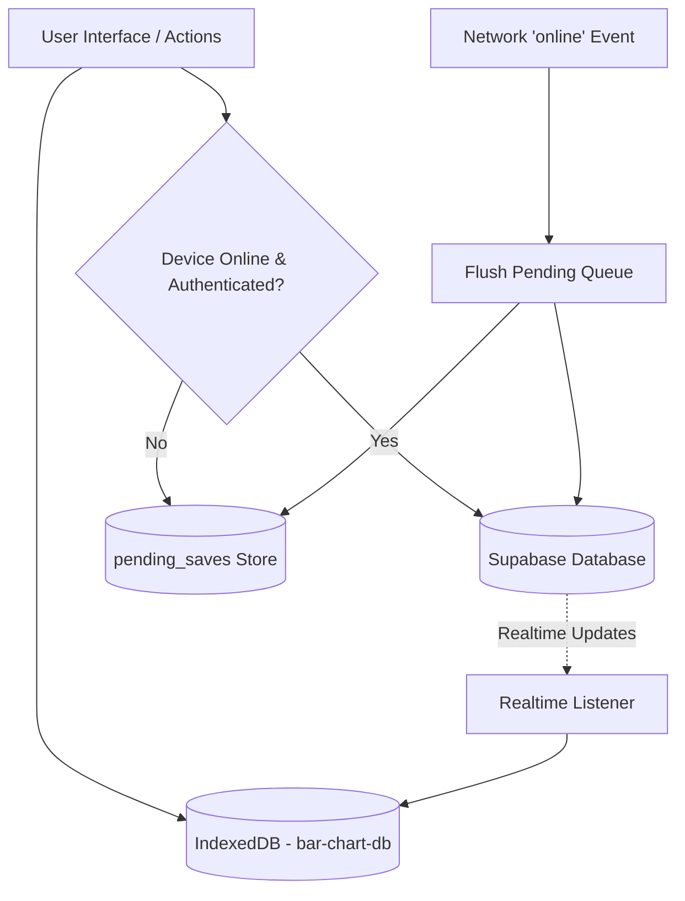
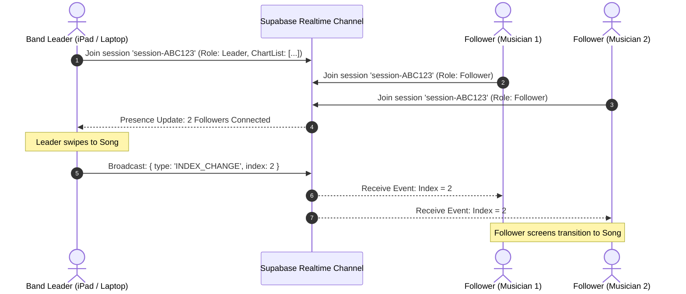

# Clypto UI / Chord-Grid — Comprehensive Application Structure & Architecture

A complete architectural and functional guide for the **Clypto UI / Chord-Grid** application — a specialized, local-first Progressive Web Application (PWA) designed for musicians, bands, and worship teams to create, arrange, transpose, organize, rehearse, synchronize live in performance, and export musical chord charts and lyrics sheets.

---

## Table of Contents

1. [Application Overview & Core Concepts](#1-application-overview--core-concepts)
2. [Technology Stack](#2-technology-stack)
3. [Complete Directory & File Structure](#3-complete-directory--file-structure)
4. [Database Schema & Data Models](#4-database-schema--data-models)
5. [Core Engine & Utility Modules (`lib/`)](#5-core-engine--utility-modules-lib)
6. [Custom React Hooks (`hooks/`)](#6-custom-react-hooks-hooks)
7. [UI Components & Providers (`components/`)](#7-ui-components--providers-components)
8. [App Router Pages & Route Structure (`app/`)](#8-app-router-pages--route-structure-app)
9. [Offline-First Architecture & Data Synchronization](#9-offline-first-architecture--data-synchronization)
10. [Live Performance Synchronization Protocol](#10-live-performance-synchronization-protocol)

---

## 1. Application Overview & Core Concepts

**Clypto UI (Chord-Grid)** provides a digital music binder experience inspired by applications like Piascore and OnSong, combining grid-based chord layout editing with modern real-time capabilities:

- **Grid-Based Chord Notations**: Songs are structured into customizable lines and blocks with 2-bar or 4-bar segments, repeat markers (`||:`, `:||:`, `||`), rehearsal labels (Verse, Chorus, Bridge), and custom cues.
- **Dynamic Transposition & Voicing Helper**: Real-time chord transposition (sharps/flats preference) and instant visual voicing tooltips showing underlying notes, intervals, and bass notes.
- **Dual Content Types**: Full support for both structured **Chord Charts** and text-based **Lyrics/Chord Pro** sheets.
- **Hierarchical Library Management**: Nested folder trees, tagging, bookmarking, soft-delete trash bin with restore capabilities, and deep search across titles, artists, and lyrics.
- **Setlist Planning & Repertoire Management**: Ordered gig/service setlist creation with custom song notes, per-setlist transpose overrides, and duplicate workflows.
- **Live Performance Sync (Band Stage Mode)**: Master-Follower real-time synchronization over Supabase Broadcast channels; when the band leader changes songs, follower devices automatically navigate in sync.
- **Local-First & Offline Engine**: Full IndexedDB offline cache (`idb`), offline pending save queue that syncs automatically when back online, and PWA Service Worker caching for zero-latency gigs without internet.
- **Print & PDF Export Engine**: Dedicated high-fidelity print layout generator with pagination controls, responsive multi-column printing, and font/color customizations.

---

## 2. Technology Stack

- **Framework**: [Next.js](https://nextjs.org/) (App Router, React 19)
- **Language**: [TypeScript](https://www.typescriptlang.org/) (Strict type-checking)
- **Styling**: [Tailwind CSS v4](https://tailwindcss.com/) + Custom CSS variables (`globals.css`)
- **Backend / Database**: [Supabase](https://supabase.com/) (PostgreSQL with Row Level Security & Realtime WebSockets)
- **Local Storage / Caching**: [IndexedDB via `idb`](https://github.com/jakearchibald/idb)
- **Drag & Drop**: `@dnd-kit/core`, `@dnd-kit/sortable`, `@dnd-kit/utilities`
- **Zoom / Pan**: `react-zoom-pan-pinch`
- **Icons**: `lucide-react`
- **PWA / Service Worker**: Custom Service Worker (`public/sw.js`) + Web App Manifest

---

## 3. Complete Directory & File Structure

```
d:/chord-grid/
├── app/                                 # Next.js App Router root
│   ├── auth/                            # Authentication route
│   │   └── page.tsx                     # Login, Registration, Password Reset & Guest Mode
│   ├── bookmarks/                       # Starred / Favorited items
│   │   └── page.tsx                     # Bookmarks manager page
│   ├── chart/                           # Chord chart viewer & editor routes
│   │   ├── [id]/                        # Dynamic chart route
│   │   │   └── page.tsx                 # Score reader / interactive editor page
│   │   └── layout.tsx                   # Dedicated chart viewer layout wrapper
│   ├── folder/                          # Nested folder navigation
│   │   └── [id]/                        # Dynamic folder route
│   │       └── page.tsx                 # Folder explorer sub-view
│   ├── lyrics/                          # Lyrics and text-based sheets
│   │   ├── [id]/                        # Lyrics reader/editor view
│   │   │   └── page.tsx                 # Piascore lyrics reader page
│   │   ├── folder/                      # Lyrics-specific folder views
│   │   │   └── [id]/                    # Dynamic lyrics folder
│   │   │       └── page.tsx             # Lyrics subfolder explorer
│   │   └── page.tsx                     # Root lyrics catalog explorer
│   ├── perform/                         # Live band stage synchronization
│   │   ├── [code]/                      # Active live session room (leader / follower)
│   │   │   └── page.tsx                 # Live rehearsal / performance stage
│   │   └── page.tsx                     # Create or join live performance session
│   ├── printer/                         # Print-ready and PDF generator
│   │   └── page.tsx                     # Multi-chart printable sheets with custom typography
│   ├── profile/                         # User profile and account
│   │   └── page.tsx                     # User details, logout, and security settings
│   ├── setlists/                        # Setlist management
│   │   ├── [id]/                        # Dynamic setlist builder
│   │   │   └── page.tsx                 # Drag-and-drop setlist editor & performance launch
│   │   └── page.tsx                     # Setlists catalog overview
│   ├── settings/                        # App settings & offline diagnostics
│   │   └── page.tsx                     # Storage diagnostics, offline sync toggle, cache purge
│   ├── trash/                           # Recycle bin / soft-delete manager
│   │   └── page.tsx                     # Deleted folders, charts, and lyrics recovery
│   ├── globals.css                      # Global Tailwind CSS and design system variables
│   ├── layout.tsx                       # Root layout with Auth, OfflineSyncProvider, and Navigation
│   └── page.tsx                         # Main Dashboard / Root Chord Charts Explorer
│
├── components/                          # Reusable UI & Business Logic Components
│   ├── AuthProvider.tsx                 # Supabase session provider & guest mode state
│   ├── ChartRenderer.tsx                # SVG / CSS grid renderer for bar lines & chords
│   ├── ChordInput.tsx                   # Specialized bar input with autocomplete & chord parsing
│   ├── FolderBrowser.tsx                # Dual-mode (Grid/List) file system browser with search & batch ops
│   ├── FolderPickerModal.tsx            # Tree-selector modal for moving folders/items
│   ├── Header.tsx                       # Top navigation bar with breadcrumbs, search & sync status
│   ├── Navigation.tsx                   # Global navigation bar controller
│   ├── OfflineSyncContext.tsx           # Global synchronization coordinator & realtime events
│   ├── PiascoreLyricsReader.tsx         # Lyrics reader with autoscroll, font scaling & transposition
│   ├── PiascoreReader.tsx               # Full-screen chart reader with tabs, metronome, transpose & zoom
│   ├── Sidebar.tsx                      # Slide-out navigation drawer for quick library access
│   ├── SongPickerModal.tsx              # Song selector modal for setlists and tabs
│   └── SWRegister.tsx                   # Client-side Service Worker registration helper
│
├── hooks/                               # Custom React Hooks
│   ├── useChartPrefetch.ts              # Background preloader for linked charts
│   ├── useChartSync.ts                  # Real-time synchronization hook for individual charts
│   ├── useLyricsSync.ts                 # Real-time synchronization hook for lyrics documents
│   ├── usePerformanceSession.ts         # Supabase Broadcast channel manager for live band sessions
│   └── useSetlistPrefetch.ts            # Preloader for charts inside a setlist
│
├── lib/                                 # Core Utilities, Engines, and Data Layer
│   ├── chart-types.ts                   # TypeScript interfaces for lines, blocks, and charts
│   ├── chord-notes.ts                   # Chord analysis, voicing, intervals, and note breakdown
│   ├── chord-parser.tsx                 # Musical chord syntax parser with superscript formatting
│   ├── lyrics.ts                        # Lyrics data models, persistence, and CRUD helpers
│   ├── setlists.ts                      # Setlists data models, item reordering, and CRUD helpers
│   ├── storage.ts                       # IndexedDB local cache engine & Supabase persistence
│   ├── supabase.ts                      # Supabase JS client configuration
│   └── transpose.ts                     # Semitone transposition engine (sharps vs flats)
│
├── public/                              # Static Assets & PWA Config
│   ├── bg.png                           # App textured dark background
│   ├── manifest.json                    # Web App Manifest for PWA installation
│   ├── sw.js                            # Offline caching service worker
│   └── icons...                         # Application icons for iOS & Android
│
├── migration.sql                        # Incremental SQL migrations
├── schema.sql                           # Full PostgreSQL database schema with RLS policies
├── package.json                         # Project dependencies and npm scripts
├── tsconfig.json                        # TypeScript configuration
└── next.config.ts                       # Next.js configuration
```

---

## 4. Database Schema & Data Models

The database schema (`schema.sql` and `migration.sql`) runs on PostgreSQL in Supabase with **Row Level Security (RLS)**.

### Core Tables

#### 1. `public.folders`
Stores hierarchical directory nodes for organizing both charts and lyrics.
- `id` (`uuid`, PK)
- `name` (`text`, required) — Folder display name (e.g. "Sunday Service", "Jazz Standards", "Trash")
- `parent_id` (`uuid`, FK → `folders.id`, ON DELETE CASCADE) — Supports infinite nesting
- `created_by` (`uuid`, FK → `auth.users.id`) — Creator UUID
- `updated_at` (`timestamptz`) — Timestamp for sync reconciliation

#### 2. `public.charts`
Stores structured chord grid songs.
- `id` (`uuid`, PK)
- `title` (`text`, required)
- `tempo` (`integer`, nullable) — BPM
- `time_sig` (`text`, nullable) — E.g., `"4/4"`, `"3/4"`, `"6/8"`
- `lines` (`jsonb`) — JSON array of `Line` objects (contains `Block`s and bar notation strings)
- `semitone_offset` (`integer`, default `0`) — Transpose offset
- `prefer_flats` (`boolean`, default `false`) — Enharmonic spelling preference
- `is_bookmarked` (`boolean`, default `false`) — Favorite flag
- `folder_id` (`uuid`, FK → `folders.id`, ON DELETE CASCADE)
- `created_by` (`uuid`, FK → `auth.users.id`)
- `updated_at` (`timestamptz`)

#### 3. `public.lyrics`
Stores text/chord-pro format lyrics sheets.
- `id` (`uuid`, PK)
- `title` (`text`, required)
- `artist` (`text`, nullable)
- `content` (`text`, required) — Raw lyrics / chords text
- `tempo` (`integer`, nullable)
- `time_sig` (`text`, nullable)
- `key` (`text`, nullable)
- `is_bookmarked` (`boolean`, default `false`)
- `folder_id` (`uuid`, FK → `folders.id`, ON DELETE CASCADE)
- `created_by` (`uuid`, FK → `auth.users.id`)
- `updated_at` (`timestamptz`)

#### 4. `public.setlists`
Stores gig setlist metadata.
- `id` (`uuid`, PK)
- `name` (`text`, required) — Setlist title (e.g., "Tour Date #1", "Worship Night")
- `date` (`date`, nullable)
- `notes` (`text`, nullable)
- `created_by` (`uuid`, FK → `auth.users.id`)
- `updated_at` (`timestamptz`)

#### 5. `public.setlist_items`
Ordered associations between setlists and items (charts or lyrics).
- `id` (`uuid`, PK)
- `setlist_id` (`uuid`, FK → `setlists.id`, ON DELETE CASCADE)
- `item_type` (`text`, check `item_type IN ('chart', 'lyrics')`)
- `item_id` (`uuid`, required) — Points to `charts.id` or `lyrics.id`
- `position` (`integer`, default `0`) — Zero-based ordering index
- `transpose_override` (`integer`, nullable) — Per-setlist key override
- `notes` (`text`, nullable) — Performance instructions (e.g. "Intro acoustic only")

---

## 5. Core Engine & Utility Modules (`lib/`)

### `lib/chart-types.ts`
Defines the core data structures that represent a music chart:
- **`Block`**: Represents a measure segment containing `bars` (array of chord strings), `startRepeat` (`||:`), and `endRepeat` (`:||`).
- **`Line`**: A row of music containing rehearsal marks (`label`, `labelRight`), colors (`labelColor`, `labelRightColor`), and an array of `Block`s.
- **`ChartData`**: The complete model representing the title, tempo, time signature, lines array, semitone offset, folder relation, and metadata.
- **Helper Factories**: `createDefaultLine()`, `createDefaultBlock()`.

### `lib/storage.ts`
The primary data engine handling local IndexedDB storage, cloud Supabase synchronization, search, import/export, and the offline pending queue:
- **`getDBPromise()`**: Initializes and returns the `idb` database connection (`bar-chart-db` v3) with stores: `charts`, `lyrics`, `folders`, `pending_saves`.
- **`listFolder(folderId, kind)`**: Reads folder contents (subfolders and songs) from IndexedDB or Supabase.
- **`createFolder(parentId, name, kind)`**: Creates new nested folder nodes with offline fallbacks.
- **`renameEntry(id, type, newName)`**: Renames charts, folders, or lyrics locally and queues cloud updates.
- **`moveEntry(id, type, newParentId)`**: Moves entries across folder hierarchies.
- **`moveToTrash(id, type)` & `restoreFromTrash(id, type, name)`**: Soft-delete system that relocates items to a special trash branch preserving recovery metadata.
- **`saveChart(chart)` & `readChart(id, bypassCache)`**: High-speed chart CRUD with local cache-first read and background cloud sync.
- **`syncAllOffline()`**: Bulk pre-fetches all cloud data into IndexedDB for full offline usage.
- **`exportChart(id)` & `importChart(file, targetFolderId)`**: JSON-based backup and cross-device import/export.
- **`searchAll(query, rootFolderId, kind)`**: Multi-attribute recursive search across songs and subfolders.

### `lib/transpose.ts`
The musical pitch calculation and transposition engine:
- **`transposeSingleChord(raw, semitones, preferFlats)`**: Transposes individual chords (handles complex extensions, slash chords like `C/E`, diminished, augmented).
- **`transposeChordString(raw, semitones, preferFlats)`**: Transposes multiple chords within a single measure (e.g. `"C G/B | Am Am7/G"`).
- **`transposeChart(chart, deltaSemitones, newPreferFlats)`**: Traverses all lines, blocks, and bars of a `ChartData` object and shifts every chord by the specified semitone delta.
- **`resetChartTranspose(chart)`**: Reverts the chart back to its original concert pitch key.

### `lib/chord-parser.tsx`
Handles musical formatting and superscript typography rendering:
- **`parseChord(raw)`**: Converts raw string representations (e.g. `"Cmaj7#11"`, `"F#m7b5"`, `"Bb/D"`) into beautiful React JSX with superscript tensions, diminished circles (`°`), major triangles (`△`), and proper accidental symbols (`♯`, `♭`).
- **`toSuperscript(str)`**: Transforms numeric chord tensions (e.g. `9`, `11`, `13`) into Unicode superscript glyphs.

### `lib/chord-notes.ts`
Musical harmonic analysis and chord voicing calculator:
- **`getChordNotes(chordName)`**: Parses roots, chord qualities (Major, Minor, 7th, 9th, sus4, dim, aug, etc.), and bass notes, returning the exact pitch breakdown (e.g. `F#m7` → `["F#", "A", "C#", "E"]`).
- **`ChordVoicingInfo`**: Type definition containing parsed root, quality name, notes array, bass note, and formatted string.

### `lib/lyrics.ts`
CRUD, parsing, and storage helper for text-based lyrics:
- **`Lyric`**: Type definition including title, artist, content, key, tempo, time signature, folder id, and timestamps.
- **`saveLyrics(lyric)` & `readLyrics(id)`**: IndexedDB and Supabase synchronization for lyrics sheets.
- **`listLyricsInFolder(folderId)`**: Retrieval helper for lyrics directories.

### `lib/setlists.ts`
Setlist generation, sequencing, and song assignment engine:
- **`listSetlists()` & `createSetlist(name, date, notes)`**: Setlist lifecycle management.
- **`addSetlistItems(setlistId, items)`**: Batch-appends charts and lyrics to a performance setlist.
- **`reorderSetlistItems(setlistId, itemIds)`**: Updates sequence indices following drag-and-drop actions.
- **`duplicateSetlist(id)`**: Deep-clones a setlist and all associated item configurations.

### `lib/supabase.ts`
Initializes and exports the typed Supabase JavaScript client using environment credentials (`NEXT_PUBLIC_SUPABASE_URL`, `NEXT_PUBLIC_SUPABASE_ANON_KEY`).

---

## 6. Custom React Hooks (`hooks/`)

### `usePerformanceSession.ts`
Powers the **Live Band Stage Mode**:
- Uses Supabase Realtime Channels (`session-{code}`) to establish an ephemeral synchronization room.
- Tracks `role` (`leader` vs `follower`), current song index (`currentIndex`), chart playlist (`chartIds`), and connected band members (`followerCount`).
- Leader broadcasts page turns and song transitions; follower devices receive websocket broadcasts and synchronize their screen without user intervention.
- Supports follower detachment (`stopFollowing()`) and re-attachment (`resumeFollowing()`).

### `useChartSync.ts`
Provides resilient real-time syncing for individual chart editors:
- Loads the chart immediately from the local IndexedDB cache for sub-millisecond response.
- Fetches the latest revision from Supabase in the background and subscribes to Realtime Postgres Changes to reflect changes made by other band members.

### `useLyricsSync.ts`
Provides instantaneous local load and real-time cloud sync for lyrics documents.

### `useChartPrefetch.ts` & `useSetlistPrefetch.ts`
Performance optimization hooks that preload adjacent charts and entire setlists into memory and IndexedDB before the user opens them, eliminating loading lag on stage.

---

## 7. UI Components & Providers (`components/`)

### `AuthProvider.tsx`
- Manages authentication state (`user`, `session`, `loading`).
- Supports Supabase email/password login, registration, password recovery, and an offline **Guest Mode** for anonymous operation.

### `OfflineSyncContext.tsx`
- Coordinates global background synchronization between Supabase and IndexedDB.
- Handles automated periodic sync, manual sync triggers, network recovery events (`online`), and real-time database update events.

### `ChartRenderer.tsx`
- The core visual component for rendering chord charts.
- Features customizable fonts, responsive font scaling, chord colors, bar marker formatting (`BarMarker`), and interactive chord voicing tooltips (`ChordNoteTooltip`).

### `PiascoreReader.tsx`
- Comprehensive performance and rehearsal score viewer.
- **Multi-Tab Workspace**: Open multiple songs simultaneously in tabs.
- **Interactive Transposition Bar**: Shift keys up/down (+/- semitones), toggle flats/sharps.
- **Visual Metronome**: Audio-visual metronome with customizable BPM and time signatures.
- **Zoom & Pan Engine**: Smooth pinch-to-zoom and double-tap zoom via `react-zoom-pan-pinch`.
- **Performance Sync Launcher**: Start or join live band sessions directly from the reader.

### `PiascoreLyricsReader.tsx`
- Specialized viewer for text-based lyrics.
- Includes adjustable automatic smooth auto-scrolling, font size sliders, transposition, and dual-column rendering.

### `FolderBrowser.tsx`
- File management view for organizing songs and folders.
- Supports **Grid View** and **List View**, multi-item batch selection, bulk moves, bulk deletes, drag-to-select, long-press contextual menus, sorting, and fast search.

### `Header.tsx` & `Sidebar.tsx`
- Top navigation bar featuring breadcrumbs, global search, and real-time offline sync indicators.
- Responsive slide-out navigation drawer with quick access to Charts, Lyrics, Setlists, Bookmarks, Trash, and Settings.

### `FolderPickerModal.tsx` & `SongPickerModal.tsx`
- Interactive modal dialogs for selecting destination folders or picking songs when assembling setlists and multi-song tabs.

### `ChordInput.tsx`
- Smart input field used in chart editing with keyboard shortcuts, chord validation, and auto-formatting.

---

## 8. App Router Pages & Route Structure (`app/`)

| Route | File Path | Description & Features |
|---|---|---|
| `/` | `app/page.tsx` | Main library dashboard displaying root chord charts, recent songs, and folders. |
| `/chart/[id]` | `app/chart/[id]/page.tsx` | Interactive chart editor and score reader for a specific song ID. |
| `/folder/[id]` | `app/folder/[id]/page.tsx` | Subfolder explorer displaying charts and child folders within that directory. |
| `/lyrics` | `app/lyrics/page.tsx` | Main catalog for text-based lyrics sheets. |
| `/lyrics/[id]` | `app/lyrics/[id]/page.tsx` | Lyrics viewer and editor with auto-scroll and key transposition. |
| `/lyrics/folder/[id]` | `app/lyrics/folder/[id]/page.tsx` | Subfolder explorer specifically for lyrics sheets. |
| `/setlists` | `app/setlists/page.tsx` | Overview of all created setlists with creation and duplicate options. |
| `/setlists/[id]` | `app/setlists/[id]/page.tsx` | Setlist detail page: drag-and-drop song ordering, per-song notes, transpose overrides, and "Start Performance" trigger. |
| `/perform` | `app/perform/page.tsx` | Performance hub: enter a 6-character room code to join as a follower or launch a new session as band leader. |
| `/perform/[code]` | `app/perform/[code]/page.tsx` | Active stage screen with real-time websocket synchronization across band members. |
| `/printer` | `app/printer/page.tsx` | Print layout generator with batch chart printing, column options, and page-break optimization. |
| `/bookmarks` | `app/bookmarks/page.tsx` | Quick-access list of all favorited/starred charts and lyrics. |
| `/trash` | `app/trash/page.tsx` | Soft-deleted items manager with one-click restore and permanent delete options. |
| `/profile` | `app/profile/page.tsx` | User profile, account information, and authentication status. |
| `/settings` | `app/settings/page.tsx` | Offline storage manager, cache diagnostics, auto-sync controls, and manual cache purge. |
| `/auth` | `app/auth/page.tsx` | User authentication: Sign In, Sign Up, Password Reset, and Guest Mode. |

---

## 9. Offline-First Architecture & Data Synchronization

The application is built around a **Local-First** model ensuring musicians never lose access to their charts during live performances where internet connections may be unstable or nonexistent:



1. **Read Path**: All page loads read directly from `IndexedDB` first for zero-latency rendering. Cloud updates are fetched asynchronously in the background.
2. **Write Path**: When an item is created or updated:
   - The change is immediately committed to local `IndexedDB`.
   - If online, it is sent to `Supabase`.
   - If offline, an action entry is added to `pending_saves`.
3. **Queue Reconciliation**: When the browser fires the `online` event, `lib/storage.ts` iterates through `pending_saves` and sends batch upserts and deletes to Supabase.
4. **Asset & Code Caching**: `public/sw.js` caches all static HTML, scripts, fonts, and assets for complete offline PWA execution.

---

## 10. Live Performance Synchronization Protocol

The live stage synchronization system allows multiple musicians on stage (e.g. Band Leader, Bassist, Vocalist) to stay in sync:



- **Ephemeral Sessions**: Rooms exist in memory via Supabase Realtime Channels (`session-{code}`) without bloating the persistent database.
- **Presence Tracking**: The leader's screen displays the live count of active follower devices.
- **Independent Transposition**: Followers can override transpositions or view lyrics instead of chords while remaining synchronized to the leader's current song index.
