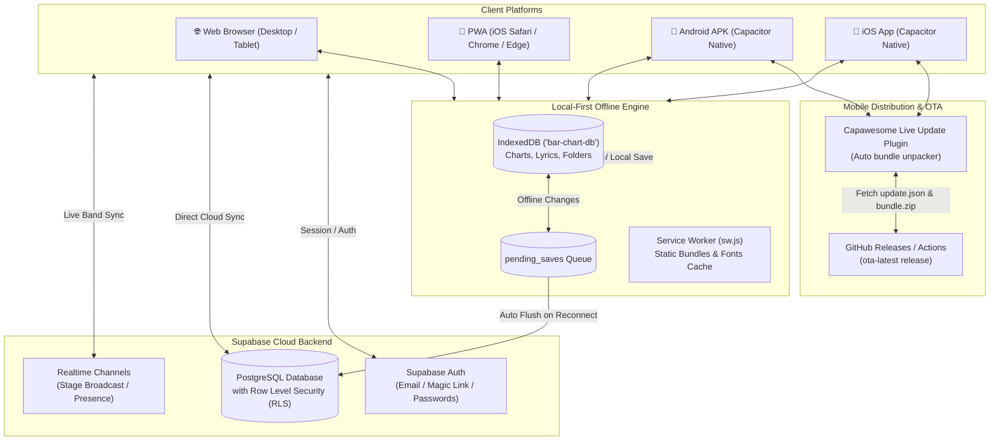

# 🎵 Chordly

<p align="center">
  <strong>The modern, local-first chord chart and lyrics sheet app built for live stage musicians, bands, and worship teams.</strong>
</p>

<p align="center">
  
  
  
  
  
  
  
  
</p>

---

## 📌 Table of Contents

- [Overview](#-overview)
- [Key Features](#-key-features)
- [System Architecture](#-system-architecture)
- [Tech Stack](#-tech-stack)
- [Directory Structure](#-directory-structure)
- [Getting Started](#-getting-started)
- [Mobile & Over-The-Air (OTA) Updates](#-mobile--over-the-air-ota-updates)
- [Database Schema & Migrations](#-database-schema--migrations)
- [NPM Scripts Reference](#-npm-scripts-reference)
- [Testing](#-testing)
- [License](#-license)

---

## 📖 Overview

**Chordly** is a high-performance digital music binder and stage assistant inspired by Piascore and OnSong. It combines structured zero-wrap grid-based chord layout editing with real-time live performance synchronization, offline-first reliability, lyrics sheets, and multi-platform native mobile builds.

Whether rehearsing in a studio, gigging on stage with spotty Wi-Fi, or leading Sunday worship, Chordly ensures every band member has instant, synchronized access to accurate charts and lyrics without screen lag.

---

## ✨ Key Features

### 🎼 Grid-Based Lead Sheets & Chord Charts
- **Structured Notation**: Songs are organized into clean measure grids with 2-bar and 4-bar stave layouts.
- **Section Grouping**: Visual section cards (Intro, Verse, Chorus, Bridge, Coda, Solo, Outro) with color tags and rehearsal notes.
- **Repeat Barlines**: Authentic musical markers including `||:`, `:||:`, `||`, and single barline dividers.
- **Superscript Chord Parser**: Formats complex chord tensions, extensions, and qualities (`Cmaj7#11`, `F#m7♭5`, `B7♭9`, slash chords `Bb/D`, diminished `°`, and augmented `+`).
- **Dynamic Transposition**: Instant semitone pitch shifting with enharmonic sharp/flat (`♯`/`♭`) preference toggles.
- **Voicing Helper & Note Breakdown**: Interactive tooltips displaying root, chord intervals, exact note pitches, and bass notes (e.g., `Am7 → A · C · E · G`).

### ⌨️ Docked Touch-First Mobile Chord Keypad
- Dedicated 4-row touch keyboard tailored for mobile musicians.
- Real-time chord monitor with active cursor (`F#m7b5|`) and voicing note pill.
- Quick keys for roots (`C`–`B`), accidental toggles (`♯`, `♭`), chord qualities (`m`, `7`, `maj7`, `sus4`, `dim`, `aug`, `9`, `6`), and rhythm symbols (`/`, `%`).
- Stepper navigation buttons (`‹ Prev`, `Next Bar ›`, `+ Bar`) for rapid authoring directly from a phone or tablet.

### 📜 Lyrics & ChordPro Reader
- Dedicated viewer and editor for text-based lyrics and chord sheets.
- **Hands-Free Autoscroll**: Smooth, adjustable autoscroll speed controls with play/pause and reset toggles.
- **Custom Viewport**: Responsive font size scaling, dual-column viewing, and key transposer.

### 🎸 Live Band Stage Sync (Master-Follower)
- Real-time room synchronization powered by **Supabase Broadcast Channels** (`/perform/[code]`).
- **Band Leader Control**: When the band leader swipes or selects a song in a setlist, all follower screens transition synchronously without manual intervention.
- **Follower Independence**: Band members can temporarily detach from the sync stream, view lyrics instead of chords, or apply personal transposition overrides while staying in the room session.
- **Presence Tracking**: Live follower count indicator shown on the leader's display.

### 💾 Local-First & Offline Engine
- **Instant Load**: Powered by **IndexedDB** (`idb`, `bar-chart-db`), loading charts and setlists locally in sub-milliseconds.
- **Offline Resilience**: Full editing capabilities offline during live gigs. Changes are queued in `pending_saves` and automatically pushed to the cloud when network connection resumes.
- **Progressive Web App (PWA)**: Complete offline caching via custom Service Worker (`public/sw.js`) and Web App Manifest (`public/manifest.json`).

### 📋 Setlists & Repertoire Management
- Assemble gig and worship service setlists with drag-and-drop reordering (`@dnd-kit`).
- Add performance instructions and song notes per setlist item (e.g. "Intro acoustic only", "Build on Chorus 2").
- Per-setlist key and transpose overrides.
- Instant setlist duplication and direct one-tap "Start Performance" launching.

### 📁 Hierarchical Library & Workspace
- Deeply nested folder tree navigation with breadcrumb trails.
- Toggle between **Grid View** and **List View** with multi-attribute sorting.
- Multi-item batch actions: bulk move, bulk delete, and folder assignment.
- Fast recursive search across song titles, artists, and lyrics.
- Dedicated Bookmarks/Favorites manager and soft-delete Trash bin with instant restore.

### 📱 Cross-Platform Mobile Apps (Android & iOS)
- Integrated with **Capacitor 8** for standalone Android APK and iOS apps.
- Safe-area insets handling, edge-to-edge support, custom dark splash screens, and animated Chordly loading spinners.
- **Over-The-Air (OTA) Live Updates**: Capawesome Live Update integration allows pushing bug fixes and UI improvements directly to installed mobile apps without requiring App Store or APK re-installations.

### 🖨️ High-Fidelity Print & PDF Export
- Dedicated print layout engine (`/printer`) optimized for physical paper binders and PDF generation.
- Responsive multi-column formatting, margin tuning, and automatic page-break controls.

---

## 🏛️ System Architecture



---

## 🛠️ Tech Stack

| Domain | Technology | Description |
|---|---|---|
| **Framework** | [Next.js 16 (App Router)](https://nextjs.org/) | Modern React framework with static export (`output: 'export'`) support |
| **UI Library** | [React 19](https://react.dev/) | Component architecture and state management |
| **Language** | [TypeScript 5](https://www.typescriptlang.org/) | Strictly typed codebase for data models and components |
| **Styling** | [Tailwind CSS v4](https://tailwindcss.com/) | Modern CSS styling with customized color palette and dark stage mode |
| **Icons** | [Lucide React](https://lucide.dev/) | Clean, consistent icons |
| **Database & Auth** | [Supabase](https://supabase.com/) | PostgreSQL, Row Level Security, Auth, and Realtime WebSockets |
| **Local Storage** | [IndexedDB (`idb`)](https://github.com/jakearchibald/idb) | Client-side database for instant-load and offline operations |
| **Drag & Drop** | `@dnd-kit/core`, `@dnd-kit/sortable` | Smooth drag-and-drop setlist reordering |
| **Score Zoom** | `react-zoom-pan-pinch` | Smooth pinch-to-zoom and pan for lead sheets |
| **Mobile Runtime** | [Capacitor 8](https://capacitorjs.com/) | Native runtime bridging web apps to Android and iOS |
| **Live Updates (OTA)** | `@capawesome/capacitor-live-update` | Remote over-the-air update system for mobile apps |
| **Testing** | [Vitest](https://vitest.dev/) & jsdom | Fast unit and integration tests |

---

## 📂 Directory Structure

```
chord-grid/
├── .github/
│   └── workflows/
│       └── build-mobile.yml            # CI/CD: Android APK, iOS, & OTA live update builder
├── android/                            # Native Android project (Capacitor)
├── app/                                # Next.js App Router
│   ├── auth/                           # Login, register, password reset & guest mode
│   ├── bookmarks/                      # Starred / favorited charts & lyrics
│   ├── chart/                          # Chord chart routes
│   │   ├── [id]/                       # Lead sheet reader & editor
│   │   │   └── edit/                   # Comprehensive grid chart editor
│   ├── chords/                         # Chord voicing library explorer
│   ├── folder/                         # Nested folder explorer
│   ├── lyrics/                         # Lyrics & ChordPro routes
│   │   ├── [id]/                       # Lyrics viewer (autoscroll, transpose)
│   │   │   └── edit/                   # Lyrics editor
│   │   └── folder/                     # Lyrics-specific subfolders
│   ├── perform/                        # Live band stage sync hub
│   │   └── [code]/                     # Active stage room (Leader / Follower)
│   ├── printer/                        # High-fidelity print / PDF layout engine
│   ├── profile/                        # User account settings & profile management
│   ├── setlists/                       # Setlist manager & builder
│   │   └── [id]/                       # Setlist detail & performance launcher
│   ├── settings/                       # Offline sync diagnostics & cache manager
│   ├── trash/                          # Soft-delete trash bin & item restore
│   ├── globals.css                     # Global styles, Tailwind setup, & CSS variables
│   ├── layout.tsx                      # Root layout wrapper (Auth, Sync, Navigation)
│   └── page.tsx                        # Main dashboard (recent charts & folders)
├── components/                         # UI Components & Context Providers
│   ├── AuthProvider.tsx                # Authentication context & offline guest mode
│   ├── ChartRenderer.tsx               # Lead sheet grid renderer & chord superscripts
│   ├── ChordInput.tsx                  # Docked 4-row mobile keypad & autocomplete
│   ├── ChordlyLoader.tsx               # Animated Chordly brand loading screen
│   ├── FolderBrowser.tsx               # Dual-mode (grid/list) library manager
│   ├── Navigation.tsx                  # Bottom/desktop navigation controller
│   ├── OfflineSyncContext.tsx          # Background cloud & IndexedDB sync manager
│   ├── PiascoreLyricsReader.tsx        # Lyrics reader with autoscroll & font zoom
│   ├── PiascoreReader.tsx              # Tabbed chart reader with metronome & zoom
│   └── Sidebar.tsx                     # Slide-out library navigation drawer
├── hooks/                              # Custom React Hooks
│   ├── useChartPrefetch.ts             # Preloads linked charts into cache
│   ├── useChartSync.ts                 # Real-time chart sync hook
│   ├── useLyricsSync.ts                # Real-time lyrics sync hook
│   └── usePerformanceSession.ts        # Supabase Realtime live band room hook
├── ios/                                # Native iOS Xcode project (Capacitor)
├── lib/                                # Core Engines & Business Logic
│   ├── chart-types.ts                  # Data types for lines, blocks, measures, charts
│   ├── chord-notes.ts                  # Harmonic voicing calculator & note breakdown
│   ├── chord-parser.tsx                # Musical chord notation & accidental formatter
│   ├── lyrics.ts                       # Lyrics persistence & CRUD operations
│   ├── setlists.ts                     # Setlist operations & item reordering
│   ├── storage.ts                      # IndexedDB + Supabase local-first sync engine
│   ├── supabase.ts                     # Supabase JS client initializer
│   └── transpose.ts                    # Musical pitch transposer (sharps/flats engine)
├── public/                             # Static assets, PWA icons, & service worker
│   ├── manifest.json                   # Web App Manifest for PWA installation
│   ├── sw.js                           # Offline caching service worker
│   └── update.json                     # Latest OTA live update manifest
├── scripts/                            # Automation & build scripts
│   ├── pack-ota.js                     # Compresses static build into OTA zip bundle
│   └── publish-ota.js                  # Releases OTA updates to GitHub Releases
├── tests/                              # Automated test suites
│   └── core.test.ts                    # Core unit tests (transposition, parsing, etc.)
├── capacitor.config.ts                 # Capacitor configuration for Android/iOS
├── next.config.ts                      # Next.js configuration (static export setup)
├── package.json                        # Project metadata & npm dependencies
└── schema.sql                          # Database schema & Row Level Security policies
```

---

## 🚀 Getting Started

### Prerequisites
- **Node.js**: `v20.x` or `v22.x`
- **npm**: `v10.x` or later
- **Git**

### 1. Clone & Install
```bash
git clone https://github.com/Dony-thomas098/bar-chart.git
cd bar-chart
npm install
```

### 2. Environment Variables
Create a `.env.local` file in the root directory:

```env
NEXT_PUBLIC_SUPABASE_URL=https://your-project.supabase.co
NEXT_PUBLIC_SUPABASE_ANON_KEY=your-supabase-anon-key
NEXT_PUBLIC_SUPABASE_PUBLISHABLE_KEY=your-supabase-anon-key
NEXT_PUBLIC_LIVE_UPDATE_URL=https://raw.githubusercontent.com/Dony-thomas098/bar-chart/main/public/update.json
```

> **Note:** Chordly includes a full **Offline Guest Mode**. You can launch and use the app immediately without signing into Supabase. All charts will be safely stored in your local browser IndexedDB.

### 3. Run the Development Server
```bash
npm run dev
```

Open [http://localhost:3000](http://localhost:3000) in your browser.

---

## 📱 Mobile & Over-The-Air (OTA) Updates

Chordly is packaged for native mobile deployment using **Capacitor 8**.

### Building for Mobile
Export the Next.js static production bundle and synchronize native assets:
```bash
npm run build:cap
```

### Opening Native IDEs
- **Android**: Open project in Android Studio:
  ```bash
  npm run android:open
  ```
- **iOS**: Open project in Xcode (macOS only):
  ```bash
  npm run ios:open
  ```

### Over-The-Air (OTA) Live Updates
Chordly integrates `@capawesome/capacitor-live-update` to push app updates directly to installed Android and iOS devices without requiring users to download a new APK or App Store release.

#### Single-Command Release
To build the app, sync Capacitor, package the bundle, and publish an OTA update:
```bash
npm run update:app
```

#### Manual Packaging & Publishing
```bash
# 1. Package the update bundle (creates dist-mobile/bundle.zip & update.json)
npm run ota:pack

# 2. Publish to GitHub Releases under tag 'ota-latest'
npm run ota:publish
```

#### Automated CI/CD
Whenever commits are pushed to the `main` branch, GitHub Actions automatically:
1. Executes static export (`npm run build:cap`).
2. Builds the Android debug APK (`app-debug.apk`).
3. Packages the OTA bundle (`bundle.zip` & `update.json`).
4. Updates the live OTA release assets.

---

## 🗄️ Database Schema & Migrations

Chordly uses PostgreSQL hosted on **Supabase** with Row Level Security (RLS) enabled on all tables.

### Tables Overview
- `folders`: Hierarchical folder directory with nested parent-child references.
- `charts`: Song title, tempo, time signature, JSON line/measure data, transposition settings, and folder ID.
- `lyrics`: Text-based song lyrics, chord lines, artist, key, tempo, and folder ID.
- `setlists`: Performance setlists with date, title, and performance notes.
- `setlist_items`: Ordered associations linking charts and lyrics to setlists with per-song transpose overrides and rehearsal notes.
- `bands` & `band_members`: Collaborative band workspaces with role-based permissions (admin, editor, viewer).

### Applying Migrations
Run the SQL scripts in the Supabase SQL Editor in the following order:
1. [schema.sql](file:///d:/chord-grid/schema.sql) — Base tables, indexes, and initial RLS policies.
2. [migrations_auth_username_email.sql](file:///d:/chord-grid/migrations_auth_username_email.sql) — Profile username and authentication enhancements.
3. [migrations_secure_rls.sql](file:///d:/chord-grid/migrations_secure_rls.sql) — Enhanced Row Level Security for shared records.
4. [migrations_shared_workspace_realtime.sql](file:///d:/chord-grid/migrations_shared_workspace_realtime.sql) — Collaborative band workspace tables & realtime replication.
5. [migrations_band_workspace.sql](file:///d:/chord-grid/migrations_band_workspace.sql) — Workspace roles, member invitations, and stage synchronization.

---

## 📜 NPM Scripts Reference

| Command | Description |
|---|---|
| `npm run dev` | Starts the Next.js development server with Webpack |
| `npm run build` | Builds the production Next.js static export bundle |
| `npm run build:cap` | Builds production bundle and syncs native Capacitor assets (`cap sync`) |
| `npm run cap:sync` | Syncs web assets to the native Android and iOS directories |
| `npm run android:open` | Opens the Android project in Android Studio |
| `npm run ios:open` | Opens the iOS project in Xcode |
| `npm run ota:pack` | Packages static build into a versioned OTA bundle zip and manifest |
| `npm run ota:publish` | Uploads OTA bundle and manifest to GitHub Releases (`ota-latest`) |
| `npm run update:app` | Builds, syncs, packages, and publishes an OTA update in one step |
| `npm run test` | Runs the test suite via Vitest |
| `npm run lint` | Runs ESLint code quality checks |

---

## 🧪 Testing

Unit tests for musical transposition, chord parsing, and notation structures are written using **Vitest**:

```bash
npm test
```

To run tests in watch mode during development:
```bash
npx vitest
```

---

## 🤝 Contributing

Contributions, bug reports, and feature requests are welcome!

1. Fork the repository.
2. Create your feature branch (`git checkout -b feature/amazing-feature`).
3. Commit your changes (`git commit -m "feat: add amazing feature"`).
4. Push to the branch (`git push origin feature/amazing-feature`).
5. Open a Pull Request.

---

## 📄 License

This project is licensed under the MIT License — see the [LICENSE](LICENSE) file for details.
