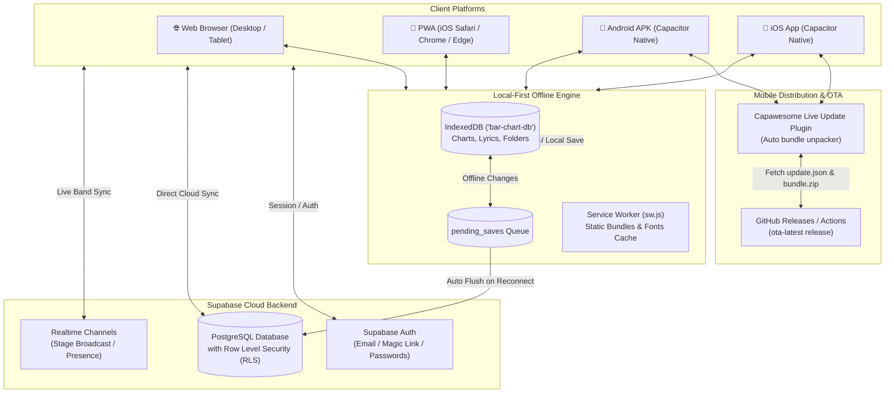
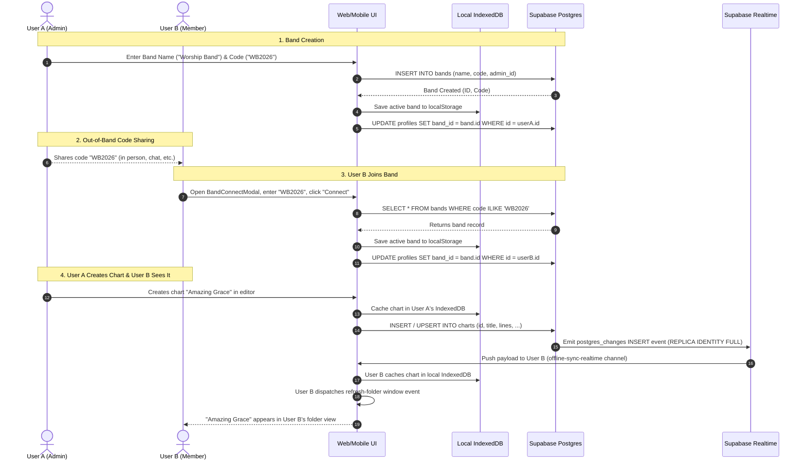

# 🎵 Chordly

<p align="center">
  <strong>The modern, local-first chord chart and lyrics sheet app built for live stage musicians, bands, and worship teams.</strong>
</p>

<p align="center">
  
  
  
  
  
  
  
  
</p>

---

## 📌 Table of Contents

- [Overview](#-overview)
- [Key Features](#-key-features)
- [System Architecture](#-system-architecture)
- [Tech Stack](#-tech-stack)
- [Directory Structure](#-directory-structure)
- [Getting Started](#-getting-started)
- [Mobile & Over-The-Air (OTA) Updates](#-mobile--over-the-air-ota-updates)
- [Database Schema & Migrations](#-database-schema--migrations)
- [Bands & Shared Workspace Sync](#-bands--shared-workspace-sync)
- [NPM Scripts Reference](#-npm-scripts-reference)
- [Testing](#-testing)
- [License](#-license)

---

## 📖 Overview

**Chordly** is a high-performance digital music binder and stage assistant inspired by Piascore and OnSong. It combines structured zero-wrap grid-based chord layout editing with real-time live performance synchronization, offline-first reliability, lyrics sheets, and multi-platform native mobile builds.

Whether rehearsing in a studio, gigging on stage with spotty Wi-Fi, or leading Sunday worship, Chordly ensures every band member has instant, synchronized access to accurate charts and lyrics without screen lag.

---

## ✨ Key Features

### 🎼 Grid-Based Lead Sheets & Chord Charts
- **Structured Notation**: Songs are organized into clean measure grids with 2-bar and 4-bar stave layouts.
- **Section Grouping**: Visual section cards (Intro, Verse, Chorus, Bridge, Coda, Solo, Outro) with color tags and rehearsal notes.
- **Repeat Barlines**: Authentic musical markers including `||:`, `:||:`, `||`, and single barline dividers.
- **Superscript Chord Parser**: Formats complex chord tensions, extensions, and qualities (`Cmaj7#11`, `F#m7♭5`, `B7♭9`, slash chords `Bb/D`, diminished `°`, and augmented `+`).
- **Dynamic Transposition**: Instant semitone pitch shifting with enharmonic sharp/flat (`♯`/`♭`) preference toggles.
- **Voicing Helper & Note Breakdown**: Interactive tooltips displaying root, chord intervals, exact note pitches, and bass notes (e.g., `Am7 → A · C · E · G`).

### ⌨️ Docked Touch-First Mobile Chord Keypad
- Dedicated 4-row touch keyboard tailored for mobile musicians.
- Real-time chord monitor with active cursor (`F#m7b5|`) and voicing note pill.
- Quick keys for roots (`C`–`B`), accidental toggles (`♯`, `♭`), chord qualities (`m`, `7`, `maj7`, `sus4`, `dim`, `aug`, `9`, `6`), and rhythm symbols (`/`, `%`).
- Stepper navigation buttons (`‹ Prev`, `Next Bar ›`, `+ Bar`) for rapid authoring directly from a phone or tablet.

### 📜 Lyrics & ChordPro Reader
- Dedicated viewer and editor for text-based lyrics and chord sheets.
- **Hands-Free Autoscroll**: Smooth, adjustable autoscroll speed controls with play/pause and reset toggles.
- **Custom Viewport**: Responsive font size scaling, dual-column viewing, and key transposer.

### 🎸 Live Band Stage Sync (Master-Follower)
- Real-time room synchronization powered by **Supabase Broadcast Channels** (`/perform/[code]`).
- **Band Leader Control**: When the band leader swipes or selects a song in a setlist, all follower screens transition synchronously without manual intervention.
- **Follower Independence**: Band members can temporarily detach from the sync stream, view lyrics instead of chords, or apply personal transposition overrides while staying in the room session.
- **Presence Tracking**: Live follower count indicator shown on the leader's display.

### 💾 Local-First & Offline Engine
- **Instant Load**: Powered by **IndexedDB** (`idb`, `bar-chart-db`), loading charts and setlists locally in sub-milliseconds.
- **Offline Resilience**: Full editing capabilities offline during live gigs. Changes are queued in `pending_saves` and automatically pushed to the cloud when network connection resumes.
- **Progressive Web App (PWA)**: Complete offline caching via custom Service Worker (`public/sw.js`) and Web App Manifest (`public/manifest.json`).

### 📋 Setlists & Repertoire Management
- Assemble gig and worship service setlists with drag-and-drop reordering (`@dnd-kit`).
- Add performance instructions and song notes per setlist item (e.g. "Intro acoustic only", "Build on Chorus 2").
- Per-setlist key and transpose overrides.
- Instant setlist duplication and direct one-tap "Start Performance" launching.

### 📁 Hierarchical Library & Workspace
- Deeply nested folder tree navigation with breadcrumb trails.
- Toggle between **Grid View** and **List View** with multi-attribute sorting.
- Multi-item batch actions: bulk move, bulk delete, and folder assignment.
- Fast recursive search across song titles, artists, and lyrics.
- Dedicated Bookmarks/Favorites manager and soft-delete Trash bin with instant restore.

### 📱 Cross-Platform Mobile Apps (Android & iOS)
- Integrated with **Capacitor 8** for standalone Android APK and iOS apps.
- Safe-area insets handling, edge-to-edge support, custom dark splash screens, and animated Chordly loading spinners.
- **Over-The-Air (OTA) Live Updates**: Capawesome Live Update integration allows pushing bug fixes and UI improvements directly to installed mobile apps without requiring App Store or APK re-installations.

### 🖨️ High-Fidelity Print & PDF Export
- Dedicated print layout engine (`/printer`) optimized for physical paper binders and PDF generation.
- Responsive multi-column formatting, margin tuning, and automatic page-break controls.

---

## 🏛️ System Architecture



---

## 🛠️ Tech Stack

| Domain | Technology | Description |
|---|---|---|
| **Framework** | [Next.js 16 (App Router)](https://nextjs.org/) | Modern React framework with static export (`output: 'export'`) support |
| **UI Library** | [React 19](https://react.dev/) | Component architecture and state management |
| **Language** | [TypeScript 5](https://www.typescriptlang.org/) | Strictly typed codebase for data models and components |
| **Styling** | [Tailwind CSS v4](https://tailwindcss.com/) | Modern CSS styling with customized color palette and dark stage mode |
| **Icons** | [Lucide React](https://lucide.dev/) | Clean, consistent icons |
| **Database & Auth** | [Supabase](https://supabase.com/) | PostgreSQL, Row Level Security, Auth, and Realtime WebSockets |
| **Local Storage** | [IndexedDB (`idb`)](https://github.com/jakearchibald/idb) | Client-side database for instant-load and offline operations |
| **Drag & Drop** | `@dnd-kit/core`, `@dnd-kit/sortable` | Smooth drag-and-drop setlist reordering |
| **Score Zoom** | `react-zoom-pan-pinch` | Smooth pinch-to-zoom and pan for lead sheets |
| **Mobile Runtime** | [Capacitor 8](https://capacitorjs.com/) | Native runtime bridging web apps to Android and iOS |
| **Live Updates (OTA)** | `@capawesome/capacitor-live-update` | Remote over-the-air update system for mobile apps |
| **Testing** | [Vitest](https://vitest.dev/) & jsdom | Fast unit and integration tests |

---

## 📂 Directory Structure

```
chord-grid/
├── .github/
│   └── workflows/
│       └── build-mobile.yml            # CI/CD: Android APK, iOS, & OTA live update builder
├── android/                            # Native Android project (Capacitor)
├── app/                                # Next.js App Router
│   ├── auth/                           # Login, register, password reset & guest mode
│   ├── bookmarks/                      # Starred / favorited charts & lyrics
│   ├── chart/                          # Chord chart routes
│   │   ├── [id]/                       # Lead sheet reader & editor
│   │   │   └── edit/                   # Comprehensive grid chart editor
│   ├── chords/                         # Chord voicing library explorer
│   ├── folder/                         # Nested folder explorer
│   ├── lyrics/                         # Lyrics & ChordPro routes
│   │   ├── [id]/                       # Lyrics viewer (autoscroll, transpose)
│   │   │   └── edit/                   # Lyrics editor
│   │   └── folder/                     # Lyrics-specific subfolders
│   ├── perform/                        # Live band stage sync hub
│   │   └── [code]/                     # Active stage room (Leader / Follower)
│   ├── printer/                        # High-fidelity print / PDF layout engine
│   ├── profile/                        # User account settings & profile management
│   ├── setlists/                       # Setlist manager & builder
│   │   └── [id]/                       # Setlist detail & performance launcher
│   ├── settings/                       # Offline sync diagnostics & cache manager
│   ├── trash/                          # Soft-delete trash bin & item restore
│   ├── globals.css                     # Global styles, Tailwind setup, & CSS variables
│   ├── layout.tsx                      # Root layout wrapper (Auth, Sync, Navigation)
│   └── page.tsx                        # Main dashboard (recent charts & folders)
├── components/                         # UI Components & Context Providers
│   ├── AuthProvider.tsx                # Authentication context & offline guest mode
│   ├── ChartRenderer.tsx               # Lead sheet grid renderer & chord superscripts
│   ├── ChordInput.tsx                  # Docked 4-row mobile keypad & autocomplete
│   ├── ChordlyLoader.tsx               # Animated Chordly brand loading screen
│   ├── FolderBrowser.tsx               # Dual-mode (grid/list) library manager
│   ├── Navigation.tsx                  # Bottom/desktop navigation controller
│   ├── OfflineSyncContext.tsx          # Background cloud & IndexedDB sync manager
│   ├── PiascoreLyricsReader.tsx        # Lyrics reader with autoscroll & font zoom
│   ├── PiascoreReader.tsx              # Tabbed chart reader with metronome & zoom
│   └── Sidebar.tsx                     # Slide-out library navigation drawer
├── hooks/                              # Custom React Hooks
│   ├── useChartPrefetch.ts             # Preloads linked charts into cache
│   ├── useChartSync.ts                 # Real-time chart sync hook
│   ├── useLyricsSync.ts                # Real-time lyrics sync hook
│   └── usePerformanceSession.ts        # Supabase Realtime live band room hook
├── ios/                                # Native iOS Xcode project (Capacitor)
├── lib/                                # Core Engines & Business Logic
│   ├── chart-types.ts                  # Data types for lines, blocks, measures, charts
│   ├── chord-notes.ts                  # Harmonic voicing calculator & note breakdown
│   ├── chord-parser.tsx                # Musical chord notation & accidental formatter
│   ├── lyrics.ts                       # Lyrics persistence & CRUD operations
│   ├── setlists.ts                     # Setlist operations & item reordering
│   ├── storage.ts                      # IndexedDB + Supabase local-first sync engine
│   ├── supabase.ts                     # Supabase JS client initializer
│   └── transpose.ts                    # Musical pitch transposer (sharps/flats engine)
├── public/                             # Static assets, PWA icons, & service worker
│   ├── manifest.json                   # Web App Manifest for PWA installation
│   ├── sw.js                           # Offline caching service worker
│   └── update.json                     # Latest OTA live update manifest
├── scripts/                            # Automation & build scripts
│   ├── pack-ota.js                     # Compresses static build into OTA zip bundle
│   └── publish-ota.js                  # Releases OTA updates to GitHub Releases
├── tests/                              # Automated test suites
│   └── core.test.ts                    # Core unit tests (transposition, parsing, etc.)
├── capacitor.config.ts                 # Capacitor configuration for Android/iOS
├── next.config.ts                      # Next.js configuration (static export setup)
├── package.json                        # Project metadata & npm dependencies
└── schema.sql                          # Database schema & Row Level Security policies
```

---

## 🚀 Getting Started

### Prerequisites
- **Node.js**: `v20.x` or `v22.x`
- **npm**: `v10.x` or later
- **Git**

### 1. Clone & Install
```bash
git clone https://github.com/Dony-thomas098/bar-chart.git
cd bar-chart
npm install
```

### 2. Environment Variables
Create a `.env.local` file in the root directory:

```env
NEXT_PUBLIC_SUPABASE_URL=https://your-project.supabase.co
NEXT_PUBLIC_SUPABASE_ANON_KEY=your-supabase-anon-key
NEXT_PUBLIC_SUPABASE_PUBLISHABLE_KEY=your-supabase-anon-key
NEXT_PUBLIC_LIVE_UPDATE_URL=https://raw.githubusercontent.com/Dony-thomas098/bar-chart/main/public/update.json
```

> **Note:** Chordly includes a full **Offline Guest Mode**. You can launch and use the app immediately without signing into Supabase. All charts will be safely stored in your local browser IndexedDB.

### 3. Run the Development Server
```bash
npm run dev
```

Open [http://localhost:3000](http://localhost:3000) in your browser.

---

## 📱 Mobile & Over-The-Air (OTA) Updates

Chordly is packaged for native mobile deployment using **Capacitor 8**.

### Building for Mobile
Export the Next.js static production bundle and synchronize native assets:
```bash
npm run build:cap
```

### Opening Native IDEs
- **Android**: Open project in Android Studio:
  ```bash
  npm run android:open
  ```
- **iOS**: Open project in Xcode (macOS only):
  ```bash
  npm run ios:open
  ```

### Over-The-Air (OTA) Live Updates
Chordly integrates `@capawesome/capacitor-live-update` to push app updates directly to installed Android and iOS devices without requiring users to download a new APK or App Store release.

#### Single-Command Release
To build the app, sync Capacitor, package the bundle, and publish an OTA update:
```bash
npm run update:app
```

#### Manual Packaging & Publishing
```bash
# 1. Package the update bundle (creates dist-mobile/bundle.zip & update.json)
npm run ota:pack

# 2. Publish to GitHub Releases under tag 'ota-latest'
npm run ota:publish
```

#### Automated CI/CD
Whenever commits are pushed to the `main` branch, GitHub Actions automatically:
1. Executes static export (`npm run build:cap`).
2. Builds the Android debug APK (`app-debug.apk`).
3. Packages the OTA bundle (`bundle.zip` & `update.json`).
4. Updates the live OTA release assets.

---

## 🗄️ Database Schema & Migrations

Chordly uses PostgreSQL hosted on **Supabase** with Row Level Security (RLS) enabled on all tables.

### Tables Overview
- `folders`: Hierarchical folder directory with nested parent-child references.
- `charts`: Song title, tempo, time signature, JSON line/measure data, transposition settings, and folder ID.
- `lyrics`: Text-based song lyrics, chord lines, artist, key, tempo, and folder ID.
- `setlists`: Performance setlists with date, title, and performance notes.
- `setlist_items`: Ordered associations linking charts and lyrics to setlists with per-song transpose overrides and rehearsal notes.
- `bands` & `band_members`: Collaborative band workspaces with role-based permissions (admin, editor, viewer).

### Applying Migrations
Run the SQL scripts in the Supabase SQL Editor in the following order:
1. [schema.sql](file:///d:/chord-grid/schema.sql) — Base tables, indexes, and initial RLS policies.
2. [migrations_auth_username_email.sql](file:///d:/chord-grid/migrations_auth_username_email.sql) — Profile username and authentication enhancements.
3. [migrations_secure_rls.sql](file:///d:/chord-grid/migrations_secure_rls.sql) — Enhanced Row Level Security for shared records.
4. [migrations_shared_workspace_realtime.sql](file:///d:/chord-grid/migrations_shared_workspace_realtime.sql) — Collaborative band workspace tables & realtime replication.
5. [migrations_band_workspace.sql](file:///d:/chord-grid/migrations_band_workspace.sql) — Workspace roles, member invitations, and stage synchronization.

---

## 🎸 Bands & Shared Workspace Sync

This section documents the current real-world implementation of collaborative bands, workspaces, and real-time synchronization in Chordly based strictly on the codebase.

---

### 1. Band Creation

* **Who Can Create a Band & UI Route**:
  * **Client-Side Authorization**: Only users whose active profile has the profession/role set to `admin` are allowed to open the **Create Band** tab in [`BandConnectModal`](file:///d:/chord-grid/components/BandConnectModal.tsx#L72-L75, #L217-L220). If a non-admin clicks the tab, an error notification is displayed: *"Only band admins can create a new band workspace. Please enter your band PIN to join."*
  * **Unlocking Admin Privileges**: Any user can unlock the `admin` profession from the Profile screen ([`app/profile/page.tsx`](file:///d:/chord-grid/app/profile/page.tsx#L584-L617, #L710-L750)) by entering the Band Leader Passcode (defaults to `"1234"`). Verification is processed locally via `verifyAdminPasscode()` in [`lib/adminAuth.ts`](file:///d:/chord-grid/lib/adminAuth.ts#L11-L14).
  * **Database RLS Authorization**: In Supabase, the RLS policy `"Allow authenticated insert bands"` in [`migrations_locked_down_security.sql`](file:///d:/chord-grid/migrations_locked_down_security.sql#L301-L305) permits any authenticated user (`TO authenticated`) to insert a row into `public.bands` provided `auth.uid() = admin_id`.
  * **Screen and Routes**:
    * **Profile Route** ([`app/profile/page.tsx`](file:///d:/chord-grid/app/profile/page.tsx#L452-L459)): Accessed by tapping **"Join / Create"** (or **"Manage Band"** if already connected) under the **Band Workspace** section.
    * **Folder / Home Route** ([`components/FolderBrowser.tsx`](file:///d:/chord-grid/components/FolderBrowser.tsx#L79-L108, #L1476-L1481)): Automatically prompts signed-in email users to join or create a band if no band association is detected on initial catalog load.
* **Band Code Generation & Storage**:
  * **Custom vs. Random**: The band code is **custom-entered** by the user into the *"Set Band Code / PIN"* input field ([`components/BandConnectModal.tsx`](file:///d:/chord-grid/components/BandConnectModal.tsx#L297-L306)). It is **not** randomly generated.
  * **Format & Validation**: The input is forced to uppercase (`e.target.value.toUpperCase()`). In [`lib/band.ts`](file:///d:/chord-grid/lib/band.ts#L305-L307), `createBand()` requires a minimum length of 2 characters (`trimmedCode.length < 2` throws an error). It verifies uniqueness by querying Supabase (`supabase.from('bands').select('id').ilike('code', trimmedCode)`); if taken, it returns *"The code '{code}' is already taken. Please choose another code."*
  * **Storage Locations**:
    * Supabase table `public.bands`: Stored in column `code` (`TEXT NOT NULL UNIQUE`) alongside `id`, `name`, and `admin_id` ([`migrations_band_workspace.sql`](file:///d:/chord-grid/migrations_band_workspace.sql#L12-L19)).
    * Supabase table `public.profiles`: Stored as foreign key `band_id` (UUID) and `band_name` (TEXT) ([`lib/band.ts`](file:///d:/chord-grid/lib/band.ts#L343-L352)).
    * Supabase Auth Metadata: Synced to `user_metadata.band_code`, `user_metadata.band_id`, and `user_metadata.band_name` via `supabase.auth.updateUser()` ([`lib/band.ts`](file:///d:/chord-grid/lib/band.ts#L353-L355)).
    * Browser `localStorage`:
      * `chord-grid-band-id` (`BAND_ID_KEY`)
      * `chord-grid-band-name` (`BAND_NAME_KEY`)
      * `chord-grid-band-joined` (`BAND_JOINED_KEY`) — stores the active code
      * `chord-grid-band-email-<email>` — cached JSON object containing `{ id, name, code, admin_id, created_at }` ([`lib/band.ts`](file:///d:/chord-grid/lib/band.ts#L15-L17, #L47-L60)).
* **Expiration, Regeneration & Revocation**:
  * **Expiration**: **Not implemented**. Band codes do not have an expiration timestamp or TTL; they persist indefinitely.
  * **Regeneration**: **Not implemented**. There is no UI button or API method to regenerate or rotate an existing band's code.
  * **Revocation**: **Not implemented**. There is no status flag (such as active/revoked) or revocation workflow in the schema or application logic.

---

### 2. Joining a Band

* **Step-by-Step Joining Flow**:
  1. Open the **Band Workspace** dialog:
     * Navigate to `/profile` ([`app/profile/page.tsx`](file:///d:/chord-grid/app/profile/page.tsx#L452-L459)), scroll to **Band Workspace**, and tap **"Join / Create"** (or **"Manage Band"**).
     * Alternatively, on the home library screen ([`components/FolderBrowser.tsx`](file:///d:/chord-grid/components/FolderBrowser.tsx#L91-L99)), the modal auto-triggers 1.5 seconds after authentication if the user has no linked band.
  2. In [`BandConnectModal`](file:///d:/chord-grid/components/BandConnectModal.tsx#L247-L275), ensure the **"Join Band"** tab is selected (default tab).
  3. Enter the Band Code / PIN into the input field (characters auto-uppercase; a helper note reminds users that the default choir PIN is `1234`).
  4. Click the gradient **"Connect to Band"** button.
  5. `joinBand(code)` in [`lib/band.ts`](file:///d:/chord-grid/lib/band.ts#L369-L417) executes:
     ```typescript
     const { data, error } = await supabase
       .from('bands')
       .select('*')
       .ilike('code', trimmedCode)
       .maybeSingle();
     ```
  6. Upon a successful match, the band object is saved to local storage (both active keys and per-email cache), a custom `band-joined` event is dispatched to the window, the user's Supabase `profiles` table is updated with `band_id` and `band_name`, and the modal auto-dismisses after 1.2 seconds.
* **Approval Requirements**:
  * **Instant**. Joining is immediate upon entering a valid code. There is no admin approval queue, confirmation prompt, or pending invitation step.
* **Multiple Bands**:
  * **No (Single Band Only)**. A user can only belong to one band at a time. The database column `profiles.band_id` is a scalar UUID reference ([`migrations_band_workspace.sql`](file:///d:/chord-grid/migrations_band_workspace.sql#L28)), and `localStorage` stores only one active band session. Joining a second band overwrites the previous band ID and code.
* **Cross-Platform Consistency**:
  * **Yes**. Web, Android (via Capacitor), and iOS (via Capacitor) execute the exact same Next.js and React code ([`BandConnectModal.tsx`](file:///d:/chord-grid/components/BandConnectModal.tsx), [`lib/band.ts`](file:///d:/chord-grid/lib/band.ts)). Supabase API calls and `localStorage` operations behave identically across all three platforms.
* **Authentication Requirement & Guest Mode**:
  * **Signed-in Users**: Full joining and syncing experience as described.
  * **Guest Mode**:
    * Unauthenticated guest users navigating to `/profile` are redirected to `/auth` ([`app/profile/page.tsx`](file:///d:/chord-grid/app/profile/page.tsx#L131-L133)).
    * The auto-prompt in [`components/FolderBrowser.tsx`](file:///d:/chord-grid/components/FolderBrowser.tsx#L80) explicitly disables itself if `localStorage.getItem('chord-grid-guest-mode') === 'true'`.
    * If `joinBand()` is called in guest mode, the Supabase SELECT query succeeds because the RLS policy `"Allow read bands"` grants public read access to `anon` ([`migrations_locked_down_security.sql`](file:///d:/chord-grid/migrations_locked_down_security.sql#L291-L294)). The band is saved into the browser's `localStorage`. However, because no Supabase auth session exists, the remote profile update is skipped. Furthermore, background cloud sync is explicitly blocked for guests in [`components/OfflineSyncContext.tsx`](file:///d:/chord-grid/components/OfflineSyncContext.tsx#L270-L272) and [`lib/storage.ts`](file:///d:/chord-grid/lib/storage.ts#L77-L81). Guests do not receive band items.

---

### 3. Roles and Permissions

* **Actual Roles in Codebase**:
  The TypeScript role definition in [`components/AuthProvider.tsx`](file:///d:/chord-grid/components/AuthProvider.tsx#L10) defines three professions:
  ```typescript
  export type UserProfession = 'singing' | 'instrument' | 'admin' | null;
  ```
  *(Note: Discrete database roles named `"editor"` and `"viewer"` are **Not implemented**. In the code, all non-admin musicians are classified as either instrumentalists or vocalists).*

* **Role Permissions Matrix (Current Implementation)**:

| Capability / Action | Admin (`admin`) | Instrumentalist (`instrument`) | Vocalist / Singer (`singing`) | Enforcement Level | File Reference |
|---|---|---|---|---|---|
| **Create Band** | ✅ Allowed | ❌ Blocked | ❌ Blocked | UI check + Supabase RLS | [`BandConnectModal.tsx#L72-L75`](file:///d:/chord-grid/components/BandConnectModal.tsx#L72-L75), [`migrations_locked_down_security.sql#L301-L305`](file:///d:/chord-grid/migrations_locked_down_security.sql#L301-L305) |
| **View / Copy Band PIN** | ✅ Full Code Shown | ❌ Masked (`••••`) | ❌ Masked (`••••`) | UI check only | [`BandConnectModal.tsx#L162-L180`](file:///d:/chord-grid/components/BandConnectModal.tsx#L162-L180) |
| **Leave / Switch Band** | ✅ Button Visible | ❌ Button Hidden | ❌ Button Hidden | UI check only | [`BandConnectModal.tsx#L189-L196`](file:///d:/chord-grid/components/BandConnectModal.tsx#L189-L196) |
| **Create Charts & Lyrics** | ✅ Allowed | ✅ Allowed | ✅ Allowed | Supabase RLS (`authenticated`) | [`AuthProvider.tsx#L22-L28`](file:///d:/chord-grid/components/AuthProvider.tsx#L22-L28), [`migrations_locked_down_security.sql#L148, #L192`](file:///d:/chord-grid/migrations_locked_down_security.sql#L148) |
| **Edit Charts & Lyrics** | ✅ Allowed | ✅ Allowed | ✅ Allowed | Supabase RLS (`authenticated`) | [`AuthProvider.tsx#L22-L28`](file:///d:/chord-grid/components/AuthProvider.tsx#L22-L28), [`migrations_locked_down_security.sql#L154, #L198`](file:///d:/chord-grid/migrations_locked_down_security.sql#L154) |
| **Move to Trash (Soft Delete)** | ✅ Allowed | ✅ Allowed | ✅ Allowed | Supabase RLS (UPDATE allowed) | [`lib/storage.ts#L479-L573`](file:///d:/chord-grid/lib/storage.ts#L479-L573) |
| **Restore from Trash** | ✅ Allowed | ✅ Allowed | ✅ Allowed | Supabase RLS (UPDATE allowed) | [`lib/storage.ts#L577-L662`](file:///d:/chord-grid/lib/storage.ts#L577-L662) |
| **Permanent Hard Delete** | ✅ Any Item | ⚠️ Only items they created | ⚠️ Only items they created | **Supabase RLS Policy** | [`migrations_locked_down_security.sql#L161-L169, #L205-L213`](file:///d:/chord-grid/migrations_locked_down_security.sql#L161-L169) |
| **Invite Members** | ❌ Not implemented | ❌ Not implemented | ❌ Not implemented | None (members self-join via PIN) | — |
| **Remove / Kick Members** | ❌ Not implemented | ❌ Not implemented | ❌ Not implemented | None | — |
| **Change Other Members' Roles** | ❌ Not implemented | ❌ Not implemented | ❌ Not implemented | None (each user sets their role in `/profile`) | — |

* **Enforcement Breakdown**:
  * **UI Only**: Hiding/showing the band code in `BandConnectModal`, the "Leave Band" button, and unlocking Admin mode via client-side passcode input ([`app/profile/page.tsx#L710-L750`](file:///d:/chord-grid/app/profile/page.tsx#L710-L750)). The client helper `canModifySection()` in [`components/AuthProvider.tsx#L22-L28`](file:///d:/chord-grid/components/AuthProvider.tsx#L22-L28) unconditionally returns `true` for all roles.
  * **Supabase RLS Enforced**: Hard deletions on `folders`, `charts`, `lyrics`, and `setlists` enforce that `created_by::text = auth.uid()::text OR EXISTS (SELECT 1 FROM public.profiles WHERE id = auth.uid() AND (role = 'admin' OR role = 'profession_admin'))` ([`migrations_locked_down_security.sql#L161-L169`](file:///d:/chord-grid/migrations_locked_down_security.sql#L161-L169)). Band updates/deletions require `auth.uid() = admin_id`.

---

### 4. What is Shared

* **Shared vs. Personal Scope**:
  * **Shared Content**: `charts`, `lyrics`, `folders`, `setlists`, `setlist_items`.
    * **Codebase Architecture Reality**: None of the content tables (`charts`, `lyrics`, `folders`, `setlists`, `setlist_items`) contain a `band_id` column (see [`schema.sql`](file:///d:/chord-grid/schema.sql), [`migrations_shared_workspace_realtime.sql`](file:///d:/chord-grid/migrations_shared_workspace_realtime.sql)).
    * All items saved to Supabase belong to a single shared catalog accessible by all authenticated users of the Supabase project instance.
    * When `listFolder()` runs in [`lib/storage.ts#L209-L228`](file:///d:/chord-grid/lib/storage.ts#L209-L228), it selects all records without any band-based filtering.
  * **Personal Content**:
    * Individual profile attributes: `role`, `instrument`, `username`, and `email` in `public.profiles`.
    * Client-side UI settings: Selected font (`chord-grid-font`), autoscroll speed, and navigation ordering preferences.
    * Unauthenticated Guest items: Any charts created in guest mode remain quarantined in the device's local IndexedDB until an account signs in.
* **Moving or Copying Between Personal and Band**:
  * **Not implemented**. Because charts do not have a `band_id` or an `is_personal` flag, there is no technical boundary between personal and band charts in the database.
* **Mutation Visibility Across Members**:
  * **Create**: When a user creates an item, it is saved to IndexedDB and sent to Supabase. Supabase Realtime fires a `postgres_changes` INSERT payload. In [`components/OfflineSyncContext.tsx#L125-L215`](file:///d:/chord-grid/components/OfflineSyncContext.tsx#L125-L215), other connected devices receive the payload, cache it in their local IndexedDB (`cacheChart`, `cacheFolder`, `cacheLyric`), and trigger `window.dispatchEvent(new CustomEvent('refresh-folder'))`. The new item appears instantly in their library.
  * **Edit**:
    * In the active chart view, [`hooks/useChartSync.ts#L61-L65`](file:///d:/chord-grid/hooks/useChartSync.ts#L61-L65) broadcasts edits over the Supabase Broadcast channel `chart-${chartId}` (`broadcast: update`). Other members viewing the same chart see live updates without refreshing.
    * Database updates trigger `postgres_changes` UPDATE in `OfflineSyncContext.tsx`, updating the cached item in IndexedDB and refreshing folder views.
  * **Soft Delete (Trash)**: [`lib/storage.ts#L479-L573`](file:///d:/chord-grid/lib/storage.ts#L479-L573) updates the item's title in Supabase with the prefix `__TRASH__:<timestamp>:<title>`. Active folder queries filter out items with this prefix. Other members' devices receive the UPDATE event, update IndexedDB, and the item disappears from their active folders and appears in `/trash`.
  * **Hard Delete**: [`lib/storage.ts#L392-L427`](file:///d:/chord-grid/lib/storage.ts#L392-L427) deletes the row from Supabase. Supabase Realtime sends a `DELETE` payload containing `old.id` (enabled by `REPLICA IDENTITY FULL`). `OfflineSyncContext.tsx` calls `deleteFromCache(payload.old.id)` on all member devices, removing it from their local IndexedDB.
  * **Restore**: [`lib/storage.ts#L577-L662`](file:///d:/chord-grid/lib/storage.ts#L577-L662) strips the `__TRASH__` prefix in Supabase. Realtime UPDATE delivers the restored record, `OfflineSyncContext.tsx` updates IndexedDB, and the item returns to active folders across all devices.

---

### 5. Live Sync

* **Supabase Realtime Channels, Tables & Filters**:
  * **Global Catalog Sync Channel**:
    * Channel Name: `offline-sync-realtime` ([`components/OfflineSyncContext.tsx#L120-L121`](file:///d:/chord-grid/components/OfflineSyncContext.tsx#L120-L121))
    * Tables: `charts`, `lyrics`, `folders`, `setlists`, `setlist_items`
    * Events: `postgres_changes` on `event: '*'`
    * Filters: **None** (listens to all table changes in the public schema).
    * Database Configuration: Tables configured with `REPLICA IDENTITY FULL` and published to `supabase_realtime` in [`migrations_shared_workspace_realtime.sql#L10-L48`](file:///d:/chord-grid/migrations_shared_workspace_realtime.sql#L10-L48).
  * **Chart Collaboration Channel**:
    * Channel Name: `chart-${chartId}` ([`hooks/useChartSync.ts#L48`](file:///d:/chord-grid/hooks/useChartSync.ts#L48))
    * Events: `postgres_changes` with `filter: 'id=eq.' + chartId`, Broadcast event `update`, and Presence tracking for collaborator email presence.
  * **Stage Performance Channel**:
    * Channel Name: `session-${code}` ([`hooks/usePerformanceSession.ts#L104`](file:///d:/chord-grid/hooks/usePerformanceSession.ts#L104))
    * Events: Broadcast events `request-state`, `sync-state`, `nav`, and `end-session`. Presence tracks stage roles (`leader` vs `follower`) and current index.
* **Live Performance Room Code vs. Band Code**:
  * **They are completely different codes**:
    * The **Band Code** is a permanent workspace identifier (e.g., `"WB2026"` or `"1234"`) stored in `public.bands.code`.
    * The **Performance Room Code** is an ephemeral, random 6-character code (e.g., `"K9F2A7"`) generated dynamically via `generateCode(6)` in [`app/perform/page.tsx#L54-L62`](file:///d:/chord-grid/app/perform/page.tsx#L54-L62) when a performance session starts.
    * The stage route `/perform/[code]` does **not** reference, require, or validate against the band code. Followers join using the session leader's 6-character stage code.
* **Offline & Reconnection Handling**:
  * **Offline**: When connectivity drops, WebSocket subscriptions disconnect. Edits continue locally in IndexedDB, and each mutation is appended to the `pending_saves` object store ([`lib/storage.ts#L40-L44, #L96-L135`](file:///d:/chord-grid/lib/storage.ts#L40-L44)).
  * **Reconnection**:
    1. The browser `online` event triggers `flushPendingSaves()` ([`lib/storage.ts#L87-L140`](file:///d:/chord-grid/lib/storage.ts#L87-L140)), which iterates through `pending_saves` and pushes pending upserts and deletes to Supabase.
    2. After a 1.5-second debounce, `OfflineSyncContext.tsx` ([`components/OfflineSyncContext.tsx#L308-L321`](file:///d:/chord-grid/components/OfflineSyncContext.tsx#L308-L321)) executes `triggerSync(false)` → `syncAllOffline()` ([`lib/storage.ts#L1195-L1245`](file:///d:/chord-grid/lib/storage.ts#L1195-L1245)), querying Supabase to pull any remote changes created by other members while offline.
* **Local Data on Leaving, Removal, or Band Deletion**:
  * **Leaving a Band**: `leaveBand()` in [`lib/band.ts#L420-L440`](file:///d:/chord-grid/lib/band.ts#L420-L440) clears `localStorage` band keys (`BAND_ID_KEY`, `BAND_NAME_KEY`, `BAND_JOINED_KEY`, and `chord-grid-band-email-<email>`), dispatches `band-left`, and sets `profiles.band_id = null` in Supabase. **Local charts and folders in IndexedDB are NOT deleted or purged.**
  * **Removal from Band**: **Not implemented**.
  * **Band Deletion**: **Not implemented** in the client UI.

---

### 6. Database

* **Tables, Columns & RLS Policies Involved**:
  * **`public.bands`** ([`migrations_band_workspace.sql#L12-L19`](file:///d:/chord-grid/migrations_band_workspace.sql#L12-L19)):
    * `id` (UUID PRIMARY KEY DEFAULT gen_random_uuid())
    * `name` (TEXT NOT NULL)
    * `code` (TEXT NOT NULL UNIQUE)
    * `admin_id` (UUID REFERENCES auth.users(id) ON DELETE SET NULL)
    * `created_at` (TIMESTAMPTZ NOT NULL DEFAULT NOW())
    * `updated_at` (TIMESTAMPTZ NOT NULL DEFAULT NOW())
    * **RLS Policies** ([`migrations_locked_down_security.sql#L289-L317`](file:///d:/chord-grid/migrations_locked_down_security.sql#L289-L317)):
      * SELECT: `"Allow read bands"` (`TO authenticated, anon USING (true)`)
      * INSERT: `"Allow authenticated insert bands"` (`TO authenticated WITH CHECK (auth.uid() = admin_id)`)
      * UPDATE: `"Allow admin update bands"` (`TO authenticated USING (auth.uid() = admin_id) WITH CHECK (auth.uid() = admin_id)`)
      * DELETE: `"Allow admin delete bands"` (`TO authenticated USING (auth.uid() = admin_id)`)
  * **`public.profiles`** ([`schema.sql#L12-L21`](file:///d:/chord-grid/schema.sql#L12-L21), [`migrations_band_workspace.sql#L22-L37`](file:///d:/chord-grid/migrations_band_workspace.sql#L22-L37)):
    * `id` (UUID PRIMARY KEY REFERENCES auth.users(id) ON DELETE CASCADE)
    * `email` (TEXT)
    * `username` (TEXT UNIQUE NOT NULL)
    * `display_name` (TEXT)
    * `role` (TEXT DEFAULT 'instrument')
    * `instrument` (TEXT)
    * `band_id` (UUID REFERENCES public.bands(id) ON DELETE SET NULL)
    * `band_name` (TEXT)
    * `created_at` (TIMESTAMPTZ NOT NULL DEFAULT NOW())
    * `updated_at` (TIMESTAMPTZ NOT NULL DEFAULT NOW())
    * **RLS Policies** ([`migrations_locked_down_security.sql#L320-L353`](file:///d:/chord-grid/migrations_locked_down_security.sql#L320-L353)):
      * SELECT: `"Allow read profiles"` (`TO authenticated, anon USING (true)`)
      * INSERT: `"Allow insert own profile"` (`TO authenticated WITH CHECK (auth.uid() = id)`)
      * UPDATE: `"Allow update own profile"` (`TO authenticated USING (auth.uid() = id) WITH CHECK (auth.uid() = id)`)
      * DELETE: `"Allow delete own profile"` (`TO authenticated USING (auth.uid() = id)`)
  * **`band_members` Table**:
    * **Not implemented**. There is no `band_members` join table in the database. Band membership is modeled entirely via the single `profiles.band_id` foreign key.
  * **`band_id` Column on Content Tables**:
    * **Not implemented / None**. The catalog tables (`folders`, `charts`, `lyrics`, `setlists`, `setlist_items`) do not contain a `band_id` column.
* **Migration Execution Order**:
  1. [`schema.sql`](file:///d:/chord-grid/schema.sql): Sets up base tables (`profiles`, `folders`, `charts`, `lyrics`, `setlists`, `setlist_items`), uuid extension, and `handle_new_user` trigger.
  2. [`migrations_auth_username_email.sql`](file:///d:/chord-grid/migrations_auth_username_email.sql): Adds `email`, `username`, and `display_name` columns and defines the `resolve_login_email` RPC.
  3. [`migrations_band_workspace.sql`](file:///d:/chord-grid/migrations_band_workspace.sql): Creates `public.bands`, adds `band_id` and `band_name` columns to `profiles`, inserts the default `'Choir Band'` with code `'1234'`, and publishes `bands` and `profiles` to `supabase_realtime`.
  4. [`migrations_shared_workspace_realtime.sql`](file:///d:/chord-grid/migrations_shared_workspace_realtime.sql): Enables `REPLICA IDENTITY FULL` on content tables and adds them to `supabase_realtime`.
  5. [`migrations_locked_down_security.sql`](file:///d:/chord-grid/migrations_locked_down_security.sql): Consolidates and hardens RLS policies across all tables, dropping wide-open policies and securing mutations while keeping read access for collaboration and stage followers. *(Supersedes the older isolation script `migrations_secure_rls.sql`)*.

---

### 7. Known Limitations

1. **Global Content Catalog (No Multi-Tenancy Isolation)**: Content tables (`charts`, `lyrics`, `folders`, `setlists`) lack a `band_id` column. All authenticated users share the same database catalog, meaning songs created in Band A are visible and synchronized to members of Band B on the same Supabase instance ([`lib/storage.ts#L209-L228`](file:///d:/chord-grid/lib/storage.ts#L209-L228)).
2. **Missing `band_members` Table & Single Band Limit**: Band membership is a single scalar column on `profiles.band_id`. Users cannot belong to multiple bands simultaneously, and admins cannot view a roster of connected members ([`migrations_band_workspace.sql#L28`](file:///d:/chord-grid/migrations_band_workspace.sql#L28)).
3. **No Member Management**: There are no admin features to invite members by email, approve join requests, kick/remove members, or promote/demote members.
4. **Client-Side Admin Role Elevation**: Unlocking the `admin` role is verified only on the client against a local passcode (default `"1234"` in [`lib/adminAuth.ts`](file:///d:/chord-grid/lib/adminAuth.ts#L1-L20)), allowing any user possessing the passcode to elevate their profile.
5. **Immutable & Non-Expiring Band Codes**: Band codes do not support expiration, regeneration, or revocation.
6. **Hardcoded Email Heuristics**: [`lib/band.ts#L258-L279`](file:///d:/chord-grid/lib/band.ts#L258-L279) contains hardcoded email substring checks (`ddosatt`, `donythomas`) that automatically link matching accounts to a hardcoded church band code (`INFANTJESUS`).
7. **Decoupled Stage Sync**: Live performance stage rooms (`/perform/[code]`) operate on ephemeral random 6-character codes and are completely disconnected from the band workspace.
8. **No Local Cache Cleanup on Leave**: Calling `leaveBand()` unlinks the active band profile but does not purge previously downloaded songs or folders from the browser's IndexedDB ([`lib/band.ts#L420-L440`](file:///d:/chord-grid/lib/band.ts#L420-L440)).

---

### 📋 Summary of Not Implemented / Unclear Features

* **Editor / Viewer Discrete Roles**: Not implemented. All authenticated users can create and edit charts and lyrics.
* **Band Code Expiration, Regeneration & Revocation**: Not implemented.
* **`band_members` Join Table**: Not implemented.
* **`band_id` Column on Content Tables (`charts`, `lyrics`, `folders`, `setlists`)**: Not implemented.
* **Moving or Copying Charts Between Personal and Band Workspaces**: Not implemented.
* **Member Invitations (Email / Shareable Link)**: Not implemented.
* **Member Removal (Kick / Ban)**: Not implemented.
* **Admin Management of Other Members' Roles**: Not implemented.
* **Band Deletion in UI**: Not implemented.
* **Local IndexedDB Cleanup on Band Departure**: Not implemented.

---

### 🔄 Sequence Diagram: Band Creation, Join, and Real-Time Chart Sync



---

## 📜 NPM Scripts Reference

| Command | Description |
|---|---|
| `npm run dev` | Starts the Next.js development server with Webpack |
| `npm run build` | Builds the production Next.js static export bundle |
| `npm run build:cap` | Builds production bundle and syncs native Capacitor assets (`cap sync`) |
| `npm run cap:sync` | Syncs web assets to the native Android and iOS directories |
| `npm run android:open` | Opens the Android project in Android Studio |
| `npm run ios:open` | Opens the iOS project in Xcode |
| `npm run ota:pack` | Packages static build into a versioned OTA bundle zip and manifest |
| `npm run ota:publish` | Uploads OTA bundle and manifest to GitHub Releases (`ota-latest`) |
| `npm run update:app` | Builds, syncs, packages, and publishes an OTA update in one step |
| `npm run test` | Runs the test suite via Vitest |
| `npm run lint` | Runs ESLint code quality checks |

---

## 🧪 Testing

Unit tests for musical transposition, chord parsing, and notation structures are written using **Vitest**:

```bash
npm test
```

To run tests in watch mode during development:
```bash
npx vitest
```

---

## 🤝 Contributing

Contributions, bug reports, and feature requests are welcome!

1. Fork the repository.
2. Create your feature branch (`git checkout -b feature/amazing-feature`).
3. Commit your changes (`git commit -m "feat: add amazing feature"`).
4. Push to the branch (`git push origin feature/amazing-feature`).
5. Open a Pull Request.

---

## 📄 License

This project is licensed under the MIT License — see the [LICENSE](LICENSE) file for details.
