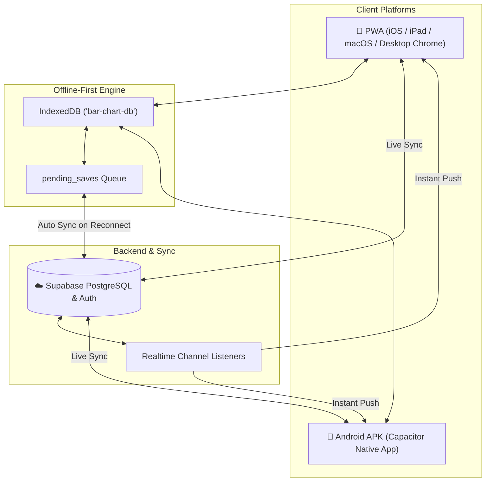

# ChordCraft: PWA & Android APK Implementation Roadmap

This document outlines the detailed roadmap, technical architecture, feasibility analysis, difficulty ratings, and step-by-step implementation guide for converting **ChordCraft** into both a **Progressive Web App (PWA)** and a **Native Android APK** with real-time cross-device cloud and offline synchronization.

---

## 1. High-Level Architecture



---

## 2. Feasibility & Possibility Assessment

### Can we do both PWA and APK?
**Yes, 100%.**
- A PWA runs in modern web browsers (Safari, Chrome, Edge, Samsung Internet) and can be installed via "Add to Home Screen" without an app store.
- An APK is a standalone native Android package (`.apk`) that can be installed directly onto any Android phone or tablet (sideloaded or published to the Google Play Store).
- Both versions share the **exact same Next.js codebase**, UI components, chord editor, and synchronization engine.

### Can the APK work online and sync changes across all devices?
**Yes, 100%.**
- **Online Mode (Default)**: Edits made on an Android APK phone/tablet immediately sync to Supabase. Any changes appear instantly on your laptop, iPad, or other phones logged into the same account.
- **Offline Mode (Stage / Gigs)**: If Wi-Fi drops at a performance venue, charts remain fully editable and viewable via local IndexedDB. Changes queue up in `pending_saves` and automatically push to the cloud the moment internet connectivity returns.

---

## 3. Implementation Phases

```mermaid
gantt
    title PWA & APK Implementation Timeline
    dateFormat  X
    axisFormat %s

    section Phase 1: PWA
    Manifest & Icon Assets        :p1_1, 0, 1
    Service Worker & Offline Cache:p1_2, 1, 2
    Install Prompt UI             :p1_3, 2, 3

    section Phase 2: Capacitor
    Install Dependencies          :p2_1, 3, 4
    Configure capacitor.config.ts :p2_2, 4, 5
    Generate Android Project      :p2_3, 5, 6

    section Phase 3: Sync & Features
    Test Offline Queue & Sync     :p3_1, 6, 7
    Native Plugins (Screen Awake) :p3_2, 7, 8

    section Phase 4: Build APK
    GitHub Actions CI/CD Pipeline :p4_1, 8, 9
    Compile .apk Download Link    :p4_2, 9, 10
```



---

### Phase 1: Production-Ready PWA
- **Difficulty**: 🟢 Low (1.5 / 5)
- **Feasibility**: 100%
- **Estimated Effort**: 1–2 hours

#### Tasks:
1. **Web App Manifest (`public/manifest.json`)**:
   - Set `display: "standalone"`.
   - Provide standard icon sizes: `192x192`, `512x512`, `maskable` icon, and SVG.
   - Configure `theme_color: "#080414"` and `background_color: "#080414"`.
   - Add app shortcuts (e.g. "Create Chart", "Perform Mode", "Setlists").
2. **Service Worker (`public/sw.js`)**:
   - Cache static bundles (`/_next/static/...`), Google Fonts, icons, and CSS.
   - Employ *Stale-While-Revalidate* caching strategy for instant page loads.
   - Ensure dynamic API requests to Supabase bypass the static cache so live data is never stale.
3. **In-App Install Prompt**:
   - Capture `beforeinstallprompt` event in Chrome/Edge.
   - Render a subtle "Install App" button in navigation/settings.
4. **iOS Safari Polish**:
   - Add `<meta name="apple-mobile-web-app-capable" content="yes">`.
   - Add `<meta name="apple-mobile-web-app-status-bar-style" content="black-translucent">`.
   - Configure `apple-touch-icon.png`.

---

### Phase 2: Capacitor Integration for Android
- **Difficulty**: 🟡 Medium (2.5 / 5)
- **Feasibility**: 100%
- **Estimated Effort**: 2 hours

#### Tasks:
1. **Dependencies**:
   ```bash
   npm install @capacitor/core @capacitor/cli @capacitor/android
   npx cap init ChordCraft com.chordcraft.app
   ```
2. **Configuration (`capacitor.config.ts`)**:
   ```typescript
   import type { CapacitorConfig } from '@capacitor/cli';

   const config: CapacitorConfig = {
     appId: 'com.chordcraft.app',
     appName: 'ChordCraft',
     webDir: 'out', // or server.url pointing to live deployment
     android: {
       allowMixedContent: true,
       backgroundColor: '#080414',
     },
     server: {
       androidScheme: 'https',
     },
   };

   export default config;
   ```
3. **Android Project Generation**:
   ```bash
   npx cap add android
   ```
4. **Native Performance Features**:
   - `@capacitor-community/keep-awake`: Prevents tablet/phone screens from sleeping or dimming during performances.
   - `@capacitor/status-bar`: Seamlessly integrates Android status and navigation bar colors.

---

### Phase 3: Cross-Device Sync & Offline Resilience
- **Difficulty**: 🟢 Low-Medium (2 / 5)
- **Feasibility**: 100%
- **Estimated Effort**: 1–2 hours

#### Tasks:
1. **Cloud Database (Supabase)**:
   - Ensure `storage.ts` saves to Supabase when online.
   - Keep auth session token persisted in `localStorage` or native secure storage.
2. **Offline Store (IndexedDB)**:
   - Reads/writes to `bar-chart-db` (`charts`, `folders`, `lyrics`, `setlists`).
   - If network fails (`navigator.onLine === false` or fetch fails), record mutations in `pending_saves`.
3. **Sync Reconciliation**:
   - Add background sync listener that triggers `syncPendingSaves()` on `window.addEventListener('online')` and app launch.
4. **Realtime Broadcast (Optional enhancement)**:
   - Subscribe to Supabase Realtime channel on active setlists: edits made on a laptop immediately update on stage tablet screens.

---

### Phase 4: APK Build & Distribution
- **Difficulty**: 🟡 Medium (3 / 5)
- **Feasibility**: 100%
- **Estimated Effort**: 1–2 hours

#### Build Options:

#### Option A: Automated Cloud Build via GitHub Actions (Recommended)
- Eliminates the need to install Android Studio, Java JDK, or Android SDK on your local Windows PC.
- Every git push (or manual dispatch button on GitHub) triggers a `.github/workflows/build-apk.yml` job.
- GitHub's cloud servers compile `app-release.apk` (or `app-debug.apk`) in ~3 minutes and offer a direct download link.

#### Option B: Local Android Studio Build
- Open the generated `android/` folder in Android Studio.
- Build menu: `Build > Build Bundle(s) / APK(s) > Build APK(s)`.
- Output file: `android/app/build/outputs/apk/debug/app-debug.apk`.

---

## 4. Difficulty & Risk Matrix

| Component | Feasibility | Difficulty | Key Risk | Mitigation Strategy |
| :--- | :---: | :---: | :--- | :--- |
| **PWA Installation** | 100% | 🟢 1.5 / 5 | Safari iOS ignores install banners. | Provide simple 2-step visual guide ("Tap Share > Add to Home Screen") for iPhone/iPad users. |
| **Capacitor Android Shell** | 100% | 🟡 2.5 / 5 | Next.js server routing vs static files. | Configure Capacitor with static build (`next export`) or point to the live hosted Vercel URL. |
| **Cross-Device Sync** | 100% | 🟢 2.0 / 5 | Offline edits conflicting across devices. | Last-write-wins timestamp strategy (`updated_at`) with local IndexedDB backup queue. |
| **APK Generation** | 100% | 🟡 3.0 / 5 | Android SDK/Gradle path configuration on Windows. | Use GitHub Actions cloud builder to produce APKs automatically with zero local SDK burden. |

---

## 5. Next Steps

When you're ready to proceed with implementation, we can follow these steps:

1. **Step 1**: Complete **Phase 1** (solidify PWA manifest, service worker caching, and install prompts).
2. **Step 2**: Complete **Phase 2 & 3** (initialize Capacitor Android project and verify sync).
3. **Step 3**: Complete **Phase 4** (set up GitHub Actions workflow or local build to generate the `.apk`).
